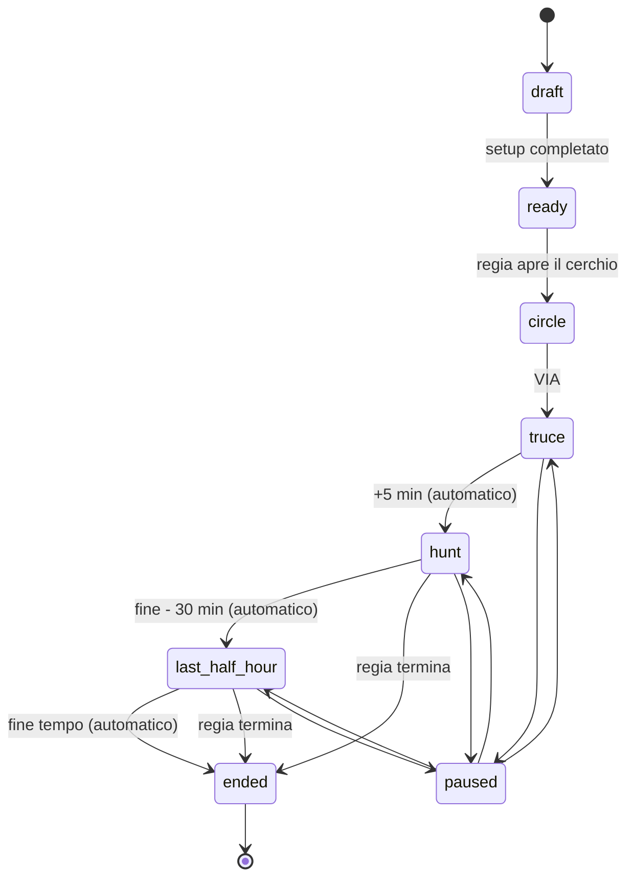

# Zero Dark Games: specifica dell'applicazione di gioco

Documento di riferimento per sviluppare l'app che gestisce una partita di **Zero Dark Games** ("I Giochi del Buio"), il gioco di softair della Zero Dark Team. Descrive regole, ruoli, dati, funzioni e criteri di accettazione. Le scelte di stack vanno adattate al progetto in cui viene inserito questo file (vedi sezione 11).

Lingua dell'interfaccia: **italiano**.

---

## 1. Il gioco in breve

- Deathmatch a **coppie**, tutti contro tutti, nel bosco, **di giorno**, durata **4 ore**.
- Ogni coppia rappresenta un **Settore** (Fuoco, Acqua, Terra…) e possiede un **codice segreto**.
- Nel bosco ci sono **punti QR cartacei** (gli "Altari"), uno per Settore. Un punto si sblocca solo con il codice del suo Settore e rilascia un **frammento di segreto**.
- Vince la prima coppia che raccoglie **tutti i frammenti** e li fa **validare** da un membro dell'organizzazione al **punto dell'organizzazione** (la "Soglia").
- I codici si ottengono vincendo ingaggi, stringendo alleanze o dalle **rivelazioni periodiche** fatte dall'app.
- Non ci sono arbitri. Combattimenti, colpiti, alleanze e cappellini si gestiscono sulla parola: **l'app non li traccia**. L'app gestisce codici, frammenti, tempi, annunci e validazione.

Il regolamento completo per i giocatori è nel book HTML "I Giochi del Buio". Questa specifica riporta solo ciò che serve all'app.

---

## 2. Glossario

L'app usa i nomi della storia nell'interfaccia giocatori e i nomi tecnici nel codice e nell'interfaccia di regia.

| Nome tecnico (codice, regia) | Nome nella storia (UI giocatori) | Descrizione |
| --- | --- | --- |
| `Game` | I Giochi | Una partita |
| `Team` | Legati | Una coppia di giocatori |
| `Sector` | Settore | Identità della coppia e del suo punto QR |
| `SectorCode` | Sigillo | Codice segreto del Settore |
| `Point` | Altare | Punto QR fisico nel bosco, uno per Settore |
| `Fragment` | Frammento della Parola | Segreto rilasciato da un punto |
| — | La Parola | L'insieme di tutti i frammenti |
| `Revelation` | Tradimento del Consiglio | Rivelazione pubblica di un codice |
| `SupplyDrop` | Doni del Consiglio | Finestra armamenti al punto centrale |
| `Validation` | Validazione alla Soglia | Verifica finale dei frammenti |
| Admin / Regia | Consiglio Zero | Organizzazione |
| Validator | Ufficiale del Consiglio | Chi valida alla Soglia |

### Settori disponibili (12)

| # | Settore | Elemento | Motto |
| --- | --- | --- | --- |
| I | Fuoco | le fornaci | Bruciamo per primi |
| II | Acqua | le dighe | Passiamo ovunque |
| III | Terra | le miniere | Restiamo |
| IV | Aria | le torri radio | Sentiamo tutto |
| V | Ferro | le officine | Non ci pieghiamo |
| VI | Legno | le segherie | Cresciamo dove cadiamo |
| VII | Sale | le saline | Conserviamo |
| VIII | Cenere | le terre bruciate | Niente da perdere |
| IX | Pietra | le cave | Aspettiamo |
| X | Ombra | i confini | Non ci vedete |
| XI | Ghiaccio | i passi d'alta quota | Resistiamo al freddo |
| XII | Fulmine | le centrali | Colpiamo una volta sola |

Si usano tanti Settori quante sono le coppie iscritte, partendo dal primo. I Settori sono dati di configurazione, non costanti nel codice.

---

## 3. Ruoli

| Ruolo | Chi | Dispositivo | Cosa fa |
| --- | --- | --- | --- |
| **Regia** (admin) | Organizzazione | PC o tablet in base | Prepara la partita, la avvia, controlla tempi e annunci, gestisce imprevisti |
| **Validatore** | Membro dell'organizzazione alla Soglia | Smartphone o tablet | Valida i frammenti delle coppie, registra vittorie e podio |
| **Coppia** | I due giocatori | Uno o due smartphone, stesso account di coppia | Vede il proprio codice, sblocca i punti, raccoglie frammenti, riceve annunci, usa i timer |

- Un account coppia può essere aperto su **più dispositivi** contemporaneamente (i due operatori).
- Regia e validatore possono coincidere.

---

## 4. Modello dati

Nomi indicativi; adattarli alle convenzioni del progetto.

### Game
| Campo | Tipo | Note |
| --- | --- | --- |
| id | id | |
| name | testo | es. "Zero Dark Games – ottobre 2026" |
| status | enum | vedi macchina a stati, sezione 5 |
| scheduledStart | data-ora | |
| startedAt | data-ora | impostato al via |
| durationMin | intero | default 240 |
| truceMin | intero | tregua iniziale, default 5 |
| firstRevelationDelayMin | intero | dall'apertura della caccia, default 30 |
| lastRevelationBeforeEndMin | intero | nessuna rivelazione nell'ultima mezz'ora, default 30 |
| neverRevealedCount | intero | default 2 |
| emergencyRadioChannel | testo | mostrato ai giocatori prima del via |
| bookUrl | url | link al regolamento |
| pausedAt / totalPausedMs | data-ora / intero | per la sospensione d'emergenza |

### Sector
| Campo | Tipo | Note |
| --- | --- | --- |
| id, order, name, element, motto | | dalla tabella della sezione 2 |
| symbol | immagine/svg | opzionale, per cartelli e UI |

### Team
| Campo | Tipo | Note |
| --- | --- | --- |
| id, gameId, sectorId | | una coppia per Settore |
| displayName | testo | nome della coppia (facoltativo, oltre al Settore) |
| members | 2 nomi o riferimenti a utenti esistenti | |
| loginToken / credenziali | | vedi sezione 9 |
| status | enum | `active`, `won`, `withdrawn` |
| finishPosition | intero | 1, 2, 3 se validata |

### SectorCode
| Campo | Tipo | Note |
| --- | --- | --- |
| sectorId, gameId | | |
| code | testo | 6 caratteri alfanumerici maiuscoli, senza caratteri ambigui (0/O, 1/I/L) |
| neverRevealed | bool | scelto a caso al setup, **mai visibile ai giocatori** |
| revelationOrder | intero o null | posizione nel calendario delle rivelazioni |

### Point
| Campo | Tipo | Note |
| --- | --- | --- |
| id, gameId, sectorId | | un punto per Settore |
| qrToken | stringa casuale lunga | finisce nell'URL del QR, non indovinabile |
| label | testo | es. "Altare del Fuoco" |
| locationNote | testo | solo regia, mai mostrato ai giocatori |

### Fragment
| Campo | Tipo | Note |
| --- | --- | --- |
| pointId | | un frammento per punto |
| text | testo | una parola o breve sequenza; vedi nota sotto |
| position | intero | posizione nella Parola, per ricomporla |

Nota: i frammenti messi in ordine compongono **la Parola** (una frase, un motto). La regia la scrive al setup; l'app la divide in tanti pezzi quanti sono i punti, oppure la regia inserisce i frammenti uno per uno.

### TeamFragment (frammenti posseduti da una coppia)
| Campo | Tipo | Note |
| --- | --- | --- |
| teamId, fragmentId | | |
| source | enum | `unlocked` (sbloccato con QR + codice) o `manual` (inserito a mano perché ricevuto da altri) |
| acquiredAt | data-ora | serve per gli spareggi |

### TeamCodeNote (taccuino dei codici raccolti)
| Campo | Tipo | Note |
| --- | --- | --- |
| teamId, sectorId, code | | annotazione della coppia; vedi 6.3 |
| addedAt | data-ora | |

### Revelation
| Campo | Tipo | Note |
| --- | --- | --- |
| gameId, sectorId | | |
| scheduledAt | offset in minuti dal via | |
| firedAt | data-ora o null | |
| status | enum | `scheduled`, `fired`, `skipped`, `manual` |

### SupplyDrop
| Campo | Tipo | Note |
| --- | --- | --- |
| gameId, scheduledAt, firedAt | | |
| description | testo | solo regia (cosa viene lasciato al Cuore) |
| message | testo | testo dell'annuncio ai giocatori |

### Announcement
| Campo | Tipo | Note |
| --- | --- | --- |
| gameId, type, text, createdAt | | `type`: `start`, `hunt_open`, `revelation`, `supply`, `last_half_hour`, `victory`, `end`, `pause`, `resume`, `free` |
| payload | json | es. settore e codice per una rivelazione |

### Validation
| Campo | Tipo | Note |
| --- | --- | --- |
| teamId, validatorId, at | | |
| result | enum | `valid`, `incomplete`, `wrong` |
| missingFragments | lista | per esito negativo |
| notes | testo | |

### EventLog
Registro di tutto ciò che succede (sblocchi, tentativi falliti, annunci, validazioni, azioni di regia), con timestamp server. Serve per contestazioni e statistiche di fine partita.

---

## 5. Macchina a stati della partita



| Stato | Significato | Effetti nell'app |
| --- | --- | --- |
| `draft` | Partita in preparazione | Solo regia |
| `ready` | Setup completo, codici e QR generati | Le coppie possono fare login e leggere regolamento e canale radio d'emergenza; **il codice non è ancora visibile** |
| `circle` | Coppie nel cerchio | Le coppie vedono il proprio codice; schermo "In attesa del via" |
| `truce` | Primi 5 minuti dopo il via | Annuncio "Via"; banner "Tregua: nessun ingaggio" con countdown; i punti si possono già sbloccare |
| `hunt` | Caccia aperta | Annuncio "Apertura della caccia"; rivelazioni e finestre armamenti attive |
| `last_half_hour` | Ultimi 30 minuti | Annuncio dedicato; nessuna nuova rivelazione |
| `paused` | Sospensione d'emergenza | Tutti i timer della partita si fermano; banner rosso "PARTITA SOSPESA" su tutti i dispositivi |
| `ended` | Fine | Annuncio di fine; sblocchi disabilitati; classifica finale |

- Tutti i tempi sono calcolati **dal server** a partire da `startedAt`, escludendo il tempo in pausa.
- La vittoria della prima coppia **non** chiude la partita: si continua per secondo e terzo posto.

---

## 6. Funzioni per ruolo

### 6.1 Regia: preparazione

1. **Crea partita** con nome, data, ora e parametri (sezione 8, tutti modificabili con i default indicati).
2. **Iscrivi le coppie**: nome dei due membri; assegnazione automatica dei Settori in ordine (modificabile a mano).
3. **Genera codici**: uno per Settore, unici, formato della sezione 4.
4. **Scegli i codici mai rivelati**: estrazione casuale di `neverRevealedCount` codici; visibile solo in regia.
5. **Calendario rivelazioni**: calcolato automaticamente (sezione 7), ordine casuale, modificabile prima del via.
6. **Inserisci la Parola** e i frammenti, uno per punto.
7. **Finestre armamenti**: orari (offset dal via) e testo; facoltative.
8. **Stampa QR**: PDF A4 con un cartello per punto: QR grande, nome dell'Altare, nome e simbolo del Settore, stile "avviso del Consiglio Zero". Niente codice, niente frammento sul cartello.
9. **Credenziali coppie**: stampa o invio di un accesso per coppia (link o QR di login, vedi sezione 9).
10. **Rigenera**: possibilità di rigenerare codici, frammenti o token QR fino al via (per esempio se un cartello è stato visto prima del gioco).

### 6.2 Regia: durante la partita

Dashboard su una sola schermata:

- **Orologio di partita** grande: tempo trascorso e tempo rimanente, stato corrente.
- **Prossimi eventi**: prossima rivelazione (settore e orario), prossima finestra armamenti, inizio ultima mezz'ora.
- **Stato coppie**: per ogni coppia settore, frammenti posseduti / totali, ultimo sblocco, stato (`active`, `won`, `withdrawn`), dispositivi online.
- **Codici**: rivelati, non ancora rivelati, mai rivelati.
- **Feed eventi** in tempo reale (sblocchi, tentativi falliti, validazioni).

Azioni manuali, ognuna con conferma nella pagina:

- Avvia (VIA), Sospendi, Riprendi, Termina.
- Rivela adesso il prossimo codice, posticipa o salta una rivelazione.
- Lancia una finestra armamenti.
- Annuncio libero a tutte le coppie.
- Ritira una coppia (`withdrawn`).
- Correggi a mano i frammenti di una coppia (con motivazione nel log).

### 6.3 Coppia

Interfaccia mobile, pensata per l'uso nel bosco (sezione 10).

**Home**
- Stato della partita e orologio (tempo rimanente; in tregua il countdown alla caccia).
- Avanzamento: "Frammenti: 4 / 8".
- Ultimo annuncio in evidenza.
- Pulsanti grandi: **Il mio Sigillo**, **Scansiona Altare**, **Frammenti**, **Codici**, **Timer**, **Annunci**, **Regolamento**.
- In fondo, sempre visibile: **canale radio d'emergenza**.

**Il mio Sigillo** (schermata da mostrare ai vincitori di un ingaggio)
- Codice a tutto schermo, carattere enorme e ad alto contrasto, nome e simbolo del Settore.
- **Orologio vivo con i secondi** sotto il codice, così si vede che non è uno screenshot.
- Si apre con un tocco dalla home, senza conferme: va mostrato in pochi secondi.

**Scansiona Altare**
- Apre la fotocamera o rimanda alla fotocamera del telefono (il QR contiene un URL, vedi sotto).
- Pagina dell'Altare: nome del punto e campo "Inserisci il Sigillo del Settore [nome]".
- Codice giusto: il frammento appare, viene salvato nei frammenti della coppia (`source = unlocked`) con vibrazione e conferma.
- Codice sbagliato: messaggio "Sigillo non valido per questo Altare". Nessun limite di tentativi (scelta di regolamento: i codici non vanno protetti), ma ogni tentativo finisce nel log.
- La pagina deve restare utilizzabile **dopo essersi allontanati dal punto**: una volta inquadrato il QR, l'Altare resta nella lista "Altari visitati" della coppia e il codice si può inserire più tardi, quando c'è rete.
- Punto già sbloccato: mostra il frammento già ottenuto.

**Frammenti**
- Lista dei frammenti posseduti nell'ordine della Parola, con caselle vuote per quelli mancanti ("Altare dell'Acqua: ?").
- **Aggiungi frammento a mano** (`source = manual`): per i frammenti ricevuti da altri. L'app verifica che il testo corrisponda a un frammento reale e lo associa al suo punto; testo non valido, messaggio di errore.
- Quando la Parola è completa: banner "Avete la Parola intera. Portatela alla Soglia."

**Codici** (taccuino)
- Elenco dei Settori con il codice se noto: il proprio, quelli rivelati dal Consiglio (aggiunti in automatico), quelli inseriti a mano dalla coppia.
- Inserimento a mano: Settore + codice. L'app **conferma se il codice è corretto** per quel Settore, così la coppia sa se le hanno mostrato un codice vero.
- Tocco su un codice: scorciatoia per sbloccare l'Altare di quel Settore, se già visitato.

**Timer**
Cronometri pronti con un tocco, con vibrazione e suono a fine tempo, funzionanti anche offline:

| Timer | Durata | Uso |
| --- | --- | --- |
| Veglia | 2 min (minimo) | Fermo col cappellino dopo una sconfitta; a fine tempo "Potete togliere il cappellino quando volete" |
| Stallo | 10 min | Durata massima di un ingaggio; a fine tempo "Pareggio" |
| Blocco ingaggio | 5 min | Dopo trattativa fallita, alleanza rotta, pareggio o riingaggio della stessa coppia |
| Trattativa | 2 min | Durata massima della trattativa d'alleanza |
| Blocco riproposta | 15 min | Prima di riproporre l'alleanza alla stessa coppia |

Più timer possono girare insieme. Sono strumenti di comodo: l'app non li impone.

**Annunci**
- Feed cronologico degli annunci del Consiglio (sezione 7.3), il più recente in alto.
- Notifica push + vibrazione all'arrivo; se il push non è disponibile, polling.
- Una rivelazione aggiunge automaticamente il codice al taccuino di tutte le coppie.

**Regolamento**
- Link al book HTML dei giocatori e riassunto "Il gioco in un minuto".

### 6.4 Validatore (la Soglia)

1. Seleziona la coppia (lista per Settore, o scansione di un QR mostrato dalla coppia).
2. Vede i frammenti della coppia **come risultano nell'app**, nell'ordine della Parola, con ✓ / ✗ per ciascuno.
3. In alternativa, digita i frammenti che la coppia gli mostra o legge: l'app li confronta con quelli attesi.
4. Esito:
   - **Valida**: tutti i frammenti presenti e corretti. La coppia passa a `won`, riceve la posizione (1, 2, 3…), parte l'annuncio di vittoria o di podio.
   - **Incompleta / errata**: elenco dei frammenti mancanti o sbagliati; la coppia resta `active` e torna in gioco.
5. Promemoria fisso in pagina per il validatore: "Si presenta una sola coppia: le alleanze vanno sciolte prima. Alla Soglia non si combatte."

---

## 7. Logiche di calcolo

### 7.1 Calendario delle rivelazioni

Definizioni (tutti i tempi in minuti dal via, pause escluse):

- `H` = apertura della caccia = `truceMin` (default 5)
- `F` = prima rivelazione = `H + firstRevelationDelayMin` (default 35)
- `L` = ultima rivelazione possibile = `durationMin - lastRevelationBeforeEndMin` (default 210)
- `N` = numero di coppie
- `R` = numero di rivelazioni = `N - neverRevealedCount`

Se `R <= 0`: nessuna rivelazione. Se `R = 1`: una sola rivelazione a `F`. Altrimenti:

```
intervallo = (L - F) / (R - 1)
rivelazione_i = F + i × intervallo     per i = 0 … R-1
```

Esempio con 8 coppie e parametri di default: R = 6, intervallo = (210 − 35) / 5 = 35 minuti; rivelazioni a 35, 70, 105, 140, 175, 210.

Regole:
- L'ordine dei Settori rivelati è casuale e deciso al setup; i codici `neverRevealed` non entrano mai nel calendario.
- Le rivelazioni proseguono anche dopo la prima vittoria.
- Se la regia rivela a mano un codice, quel Settore esce dal calendario e gli orari successivi non cambiano.
- In pausa il calendario si ferma; alla ripresa riparte da dove era.

### 7.2 Classifica finale

1. Coppie validate, in ordine di validazione.
2. Le altre coppie `active`, per numero di frammenti posseduti (decrescente).
3. A parità di frammenti, vince chi ha ottenuto l'ultimo frammento prima (`acquiredAt` più basso).
4. Coppie `withdrawn` escluse.

Da decidere con l'organizzazione: se i frammenti `manual` contano come quelli `unlocked` per la classifica. Default proposto: contano uguale.

### 7.3 Annunci predefiniti

Testi modificabili in regia. Le parti tra parentesi quadre si compilano in automatico.

| Evento | Quando | Testo |
| --- | --- | --- |
| `start` | Al VIA | I Giochi del Buio sono cominciati. Il bosco è in tregua per cinque minuti. |
| `hunt_open` | Fine tregua | La tregua è finita. Il Consiglio apre la caccia. |
| `revelation` | Da calendario | Il Consiglio ha deciso. Il Sigillo del Settore [settore] è: [codice]. Ora è di tutti. |
| `supply` | Finestra armamenti | Il Consiglio è generoso. Al Cuore vi aspettano dei doni. Andate a prenderli, se avete il coraggio. |
| `last_half_hour` | Fine − 30 min | Restano trenta minuti. Il Consiglio non tradirà più nessuno. Da adesso ogni Sigillo va strappato con le armi. |
| `victory` | Prima validazione | La Parola è stata pronunciata alla Soglia. Il Settore [settore] è libero. I Giochi continuano per il secondo e il terzo posto. |
| `podium` | Seconda e terza validazione | Il Settore [settore] ha raggiunto la Soglia ed è [secondo/terzo]. |
| `pause` | Sospensione | PARTITA SOSPESA. Fermatevi e ascoltate il canale radio d'emergenza. |
| `resume` | Ripresa | La partita riprende. |
| `end` | Fine tempo | I Giochi del Buio sono finiti. Abbassate le armi e tornate al Cuore. |

---

## 8. Parametri configurabili

| Parametro | Default | Note |
| --- | --- | --- |
| Durata partita | 240 min | |
| Tregua iniziale | 5 min | |
| Prima rivelazione dopo l'apertura della caccia | 30 min | |
| Nessuna rivelazione negli ultimi | 30 min | |
| Codici mai rivelati | 2 | |
| Lunghezza codice | 6 | alfanumerico senza caratteri ambigui |
| Timer Veglia / Stallo / Blocco / Trattativa / Riproposta | 2 / 10 / 5 / 2 / 15 min | solo lato coppia |
| Canale radio d'emergenza | — | testo libero |
| Link regolamento | — | URL del book |

Parametri del regolamento che **non** riguardano l'app (per riferimento): massimo 3 coppie per alleanza, 20 m dal QR e dai colpiti in Veglia, potenza sotto 1 J.

---

## 9. Sicurezza e accesso

- **Login coppia**: un accesso per coppia (link con token o QR da inquadrare), valido su più dispositivi. Niente password complicate: si fa nel cerchio prima del via.
- **Codici**: un codice è visibile solo alla propria coppia, alle coppie che lo inseriscono correttamente nel taccuino e a tutti dopo la rivelazione. Non deve mai arrivare al client per altre vie (niente liste complete nelle risposte API, niente codici nel bundle).
- **Frammenti**: inviati al client solo dopo uno sblocco o un inserimento manuale corretto.
- **Token QR**: casuali e lunghi, uno per punto, rigenerabili fino al via. L'URL del QR è sempre lo stesso per tutti: è voluto (il regolamento permette di passarlo ad altri). Lo sblocco richiede però una coppia autenticata.
- **Codici mai rivelati e calendario**: solo regia.
- **Orario**: fa fede il server. Il client mostra i tempi sincronizzandosi con l'ora del server.
- **Ruoli**: regia e validatore separati dalle coppie; azioni di regia registrate nell'EventLog con autore.
- Nessun limite di tentativi sui codici (scelta di regolamento), ma rate limit tecnico anti-abuso sulle API (es. 30 richieste/minuto per coppia).

---

## 10. Requisiti per l'uso in campo

- **Mobile first**, installabile come PWA.
- **Copertura scarsa nel bosco**:
  - shell dell'app, regolamento, codice della coppia, taccuino, frammenti e timer disponibili **offline** dalla cache;
  - inserimenti fatti senza rete (codice in un Altare, frammento manuale, codice nel taccuino) messi in coda e inviati appena torna la rete, con stato visibile ("in attesa di rete");
  - al ritorno della rete, recupero automatico degli annunci persi.
- **Leggibilità sotto il sole**: alto contrasto, testi grandi, pulsanti di almeno 56 px, utilizzabili con i guanti.
- **Batteria**: tema scuro di default, niente animazioni continue, aggiornamenti in push e non in polling stretto.
- **Notifiche**: push con vibrazione per gli annunci; nessun suono a meno che la coppia non lo attivi (nel softair il rumore tradisce la posizione).
- **Schermo del Sigillo**: tiene lo schermo acceso mentre è aperto (wake lock), se disponibile.
- **Niente geolocalizzazione**: l'app non traccia la posizione delle coppie.

---

## 11. Integrazione con il gestionale esistente

Il gestionale della squadra è online su **ops.zerodarkteam.it**. Prima di scrivere codice:

1. Leggere il progetto in cui si trova questo file e riusarne stack, autenticazione, stile e convenzioni.
2. Integrare la partita come modulo del gestionale (es. sezione "Giocate" → giocata Zero Dark Games), se il gestionale ha già un concetto di evento o giocata.
3. Riusare gli utenti esistenti per regia e validatore; per le coppie, collegare i membri agli utenti del gestionale quando esistono, ma permettere giocatori esterni (ospiti senza account).
4. Il book dei giocatori ("I Giochi del Buio", HTML) va allegato alla giocata e linkato dall'app.

Se il gestionale non ha un concetto adatto, creare il modulo come sezione indipendente con le stesse convenzioni.

---

## 12. Fuori ambito

- Tracciamento di colpiti, ingaggi, alleanze e cappellini: si gestiscono sulla parola.
- Posizione GPS delle coppie, mappe dal vivo.
- Chat tra coppie.
- Pagamenti e iscrizioni a pagamento.

---

## 13. Criteri di accettazione

1. Con 8 coppie e parametri di default, il calendario genera 6 rivelazioni a 35, 70, 105, 140, 175 e 210 minuti dal via; 2 codici non compaiono mai.
2. Una coppia non vede il proprio codice prima dello stato `circle`.
3. Al VIA tutte le coppie ricevono l'annuncio di inizio; dopo 5 minuti quello di apertura della caccia, senza azioni manuali.
4. Inquadrando il QR dell'Altare del Fuoco e inserendo il codice del Fuoco, la coppia ottiene il frammento del Fuoco; con il codice dell'Acqua ottiene un errore.
5. Una coppia che inquadra un QR senza rete può inserire il codice più tardi; lo sblocco va a buon fine appena torna la connessione.
6. Un frammento inserito a mano viene accettato solo se corrisponde a un frammento reale.
7. Un codice inserito a mano nel taccuino viene segnato come corretto o sbagliato per quel Settore.
8. Una rivelazione aggiunge il codice al taccuino di tutte le coppie e invia una notifica.
9. In pausa tutti gli orologi e il calendario si fermano; alla ripresa ripartono senza saltare eventi.
10. Il validatore vede i frammenti mancanti di una coppia incompleta; una coppia completa passa a `won` con la sua posizione e parte l'annuncio corretto.
11. Dopo la prima vittoria le rivelazioni continuano e le altre coppie possono ancora sbloccare punti.
12. A fine tempo gli sblocchi sono disabilitati e la classifica segue le regole della sezione 7.2.
13. Il PDF dei cartelli contiene un QR per punto con nome dell'Altare e del Settore, senza codici né frammenti.
14. La schermata del Sigillo mostra codice, Settore e un orologio con i secondi, leggibile al sole.

---

## 14. Domande aperte

- Frammenti `manual` e `unlocked` hanno lo stesso peso in classifica? (default: sì)
- La Parola è una frase unica scritta dalla regia o una sequenza di parole casuali?
- Il validatore deve poter scansionare un QR personale della coppia, o basta sceglierla dalla lista?
- Le finestre armamenti sono a orari fissi o lanciate a mano dalla regia?
